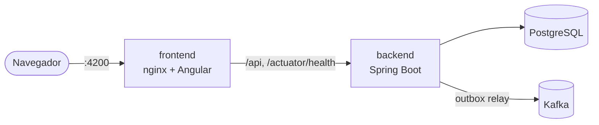

# LocGym

[](https://github.com/FelipeSEugenio/LocGym/actions/workflows/ci.yml)

Sistema web **multi-tenant** de gestão para academias de Jiu-Jitsu: alunos, planos, matrículas com cobrança recorrente, inadimplência, horários, check-in por QR Code e relatórios — cada academia com seus dados totalmente isolados.

> **Estado:** Fases 1 (Fundação), 2 (Identidade e cadastros), 3 (Matrículas e pagamentos) e 4 (Frequência) concluídas — login seguro, isolamento entre academias na aplicação e no banco (RLS), auditoria, cadastros, matrículas com cobrança recorrente, inadimplência e rotina diária multi-tenant, grade de horários e check-in por QR Code rotativo assinado lido pela câmera na recepção, publicando eventos no Kafka. Próxima: portal do aluno e relatórios — veja o [roadmap](docs/08-roadmap.md).

## Stack

| Camada | Tecnologia |
|---|---|
| Frontend | Angular 22 (standalone + signals), Angular Material, Vitest, ESLint |
| Backend | Java 21, Spring Boot 4.2, Spring Security (JWT RS256), Spring Modulith, Spring Data JPA/Hibernate (`@TenantId`), Flyway, springdoc-openapi |
| Dados | PostgreSQL 17 com Row-Level Security |
| Mensageria | Apache Kafka 4.3 (KRaft), transactional outbox |
| Testes | JUnit 5, Testcontainers, ArchUnit |
| Infra | Docker, Docker Compose, GitHub Actions |

## Arquitetura



Monolito modular com Clean Architecture por módulo, regras de arquitetura verificadas em teste, eventos publicados via transactional outbox (ordem preservada, retry, at-least-once). O backend continua pronto mesmo com o Kafka fora do ar. Detalhes em [docs/05-arquitetura.md](docs/05-arquitetura.md) e nas [decisões técnicas](docs/09-decisoes-tecnicas.md).

## Como rodar

Pré-requisito: **Docker** com Docker Compose.

```bash
cp .env.example .env
docker compose up -d --build --wait
```

| O quê | Onde |
|---|---|
| Aplicação | http://localhost:4200 |
| Swagger UI | http://localhost:8080/swagger-ui.html |
| Health check | http://localhost:8080/actuator/health |
| Métricas | http://localhost:8080/actuator/prometheus |
| Kafka UI (opcional) | `docker compose --profile tools up -d` → http://localhost:8081 |

### Primeiro acesso

1. Abra http://localhost:4200 e clique em **Criar minha academia** — você cria sua conta e a primeira academia e já entra no painel.
2. No painel, cadastre planos, professores e alunos. Cada aluno recebe uma senha inicial e troca no primeiro acesso.
3. Em **Matrículas → Nova matrícula**, matricule um aluno num plano e registre o pagamento da primeira cobrança: a matrícula fica ATIVA. **Cobranças** e **Inadimplência** mostram a situação financeira. Para ver a rotina diária agir na hora (perfil `dev`), chame `POST /api/v1/dev/rotina-diaria` com o token de um admin.
4. Para ver o portal do aluno, saia e entre com o e-mail e a senha inicial do aluno.

| Variável (`.env`) | Para quê |
|---|---|
| `POSTGRES_USER` / `POSTGRES_PASSWORD` | Dono do schema — usado pelas migrations. |
| `DB_APP_USER` / `DB_APP_PASSWORD` | Papel da aplicação (`locgym_app`), sem permissão para ignorar o RLS. |
| `JWT_CHAVE_PRIVADA` (opcional) | Chave RSA (PEM PKCS#8) que assina os tokens. Sem ela, uma chave temporária é gerada a cada subida e as sessões não sobrevivem a reinícios. |
| `CHECKIN_CHAVE_QR` (opcional) | Chave HMAC do QR de check-in (Base64 de 32 bytes: `openssl rand -base64 32`). Sem ela, uma temporária é gerada a cada subida. A câmera do navegador só funciona em `localhost` ou HTTPS. |

Parar: `docker compose down` (os dados ficam nos volumes; `docker compose down -v` apaga tudo).

## Desenvolvimento

Pré-requisitos adicionais: **JDK 21** e **Node 24** (Docker continua necessário para os testes de integração).

```bash
# Backend — testes unitários, de arquitetura e de integração (Testcontainers)
cd backend && ./mvnw verify

# Frontend
cd frontend && npm ci
npx ng lint && npx ng test --watch=false && npx ng build
npx ng serve            # http://localhost:4200, com proxy para o backend em :8080
```

Para rodar o backend fora do Docker contra a infraestrutura do compose:
`docker compose up -d postgres kafka` e `KAFKA_BOOTSTRAP_SERVERS=localhost:9094 ./mvnw spring-boot:run -Dspring-boot.run.profiles=dev`.

## Estrutura

```
├── backend/            Spring Boot (com.locgym.<modulo>/{dominio,aplicacao,infraestrutura,web})
├── frontend/           Angular (core/, layout/, paginas/)
├── docs/               documentação técnica (01–09) e specs/planos
├── docker-compose.yml
└── .github/workflows/  CI
```

## Documentação

1. [Visão geral](docs/01-visao-geral.md)
2. [Requisitos funcionais](docs/02-requisitos-funcionais.md)
3. [Requisitos não funcionais](docs/03-requisitos-nao-funcionais.md)
4. [Modelo de dados](docs/04-modelo-de-dados.md)
5. [Arquitetura](docs/05-arquitetura.md)
6. [API](docs/06-api.md)
7. [Eventos](docs/07-eventos.md)
8. [Roadmap](docs/08-roadmap.md)
9. [Decisões técnicas](docs/09-decisoes-tecnicas.md)
