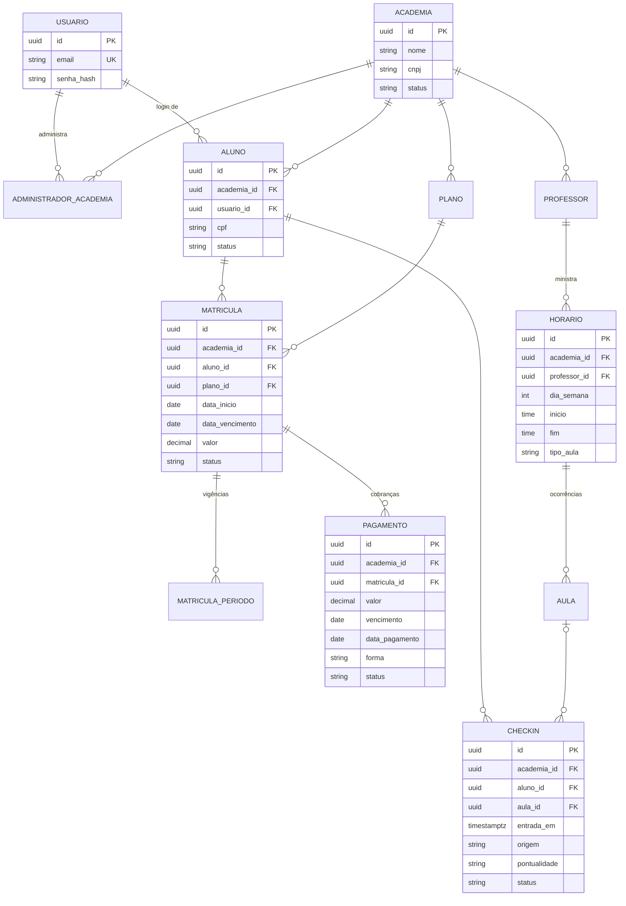

# 04 — Modelo de dados

Banco: **PostgreSQL 17**, migrations versionadas com **Flyway** (`backend/src/main/resources/db/migration`). Identificadores `uuid`; datas em `timestamptz`; regras de data de negócio no fuso `America/Sao_Paulo`.

## Implementado (Fase 1)

### `outbox_evento` — `V1__outbox_evento.sql`

| Coluna | Tipo | Descrição |
|---|---|---|
| `id` | uuid PK | Também é o `evento_id` do envelope. |
| `sequencia` | bigint identity, único | Ordem de gravação; o relay publica nessa ordem. |
| `tipo` | varchar(100) | Tipo do evento = nome do tópico Kafka. |
| `academia_id` | uuid, nulo | Tenant do evento; chave da mensagem Kafka. |
| `versao` | int | Versão do contrato do evento. |
| `payload` | jsonb | Envelope completo, exatamente como é publicado. |
| `ocorrido_em` | timestamptz | Momento em que o evento foi gerado. |
| `publicado_em` | timestamptz, nulo | Nulo enquanto pendente. |
| `tentativas` | int | Falhas de publicação acumuladas. |
| `ultimo_erro` | text | Última falha de publicação. |

Índice parcial `ix_outbox_evento_pendente (sequencia) where publicado_em is null`.

## Planejado (Fases 2–5)

Toda tabela de tenant tem `academia_id` (FK, indexado), `criado_em`, `atualizado_em` e, quando aplicável, `status`.

Restrições relevantes do design:
- `aluno`: `UNIQUE (academia_id, cpf)`.
- `matricula`: no máximo uma não cancelada por `(academia_id, aluno_id)` (índice único parcial).
- Tabelas de apoio previstas: `refresh_token`, `matricula_suspensao`, `notificacao`, `auditoria`, `configuracao_academia` (antecedência de cobrança, carência, tolerância de pontualidade).
