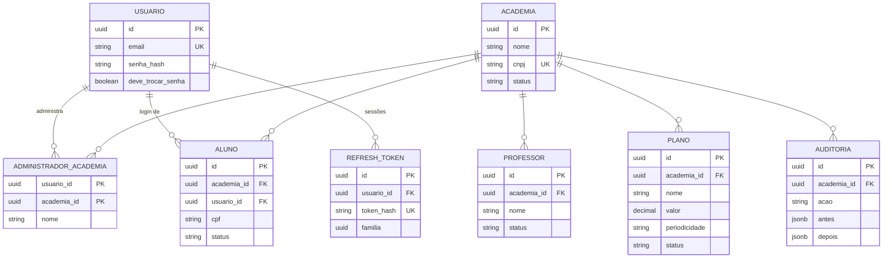
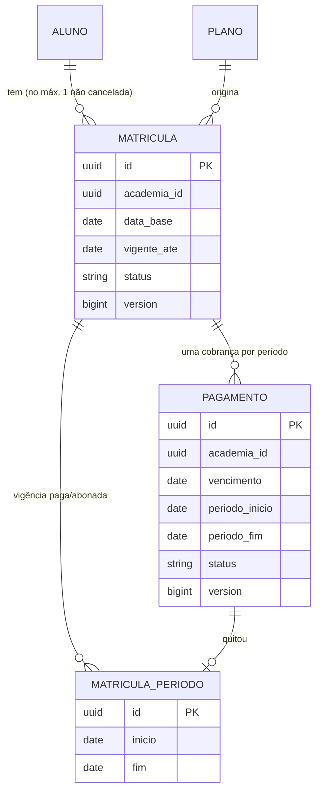
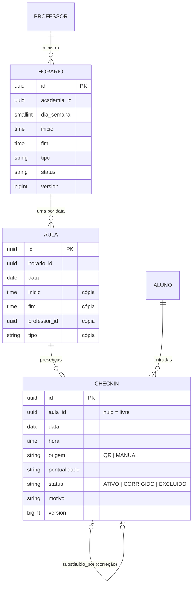

# 04 — Modelo de dados

Banco: **PostgreSQL 17**, migrations versionadas com **Flyway** (`backend/src/main/resources/db/migration`). Identificadores `uuid`; datas em `timestamptz`; regras de data de negócio no fuso `America/Sao_Paulo`.

## Papéis de banco

| Papel | Uso | Características |
|---|---|---|
| `locgym` (`DB_USER`) | Flyway (migrations) | Dono do schema. |
| `locgym_app` (`DB_APP_USER`) | Aplicação em execução | Criado pela V2; **não é superusuário, não é dono das tabelas, `NOBYPASSRLS`**; só `SELECT/INSERT/UPDATE/DELETE`. Os testes de integração também rodam com ele. |

## Tabelas implementadas

### Globais (sem RLS — acesso controlado pela aplicação)

| Tabela | Migration | Campos principais |
|---|---|---|
| `usuario` | V2 | `email` único (sempre minúsculo), `nome`, `senha_hash` (BCrypt), `deve_trocar_senha`. Credencial de login, sem perfil. |
| `academia` | V2 | `nome`, `cnpj` único (14 dígitos), endereço, `estado` (UF), `cep` (8 dígitos), telefone, e-mail, `status` ATIVA/INATIVA. |
| `administrador_academia` | V2 | PK (`usuario_id`, `academia_id`) + `nome` (nome informado para esta academia). |
| `refresh_token` | V2 | `token_hash` único (SHA-256 — o valor bruto nunca é gravado), `familia` (sessão), `expira_em`, `usado_em`, `revogado_em`. |
| `outbox_evento` | V1 | Eventos pendentes/publicados (ver [07](07-eventos.md)). |

### De tenant (`academia_id` obrigatório + RLS forçado)

| Tabela | Migration | Campos principais e restrições |
|---|---|---|
| `aluno` | V3 | `usuario_id`, `nome`, `cpf` (11 dígitos), telefone, `data_nascimento`, endereço, `status` ATIVO/INATIVO/CANCELADO. `UNIQUE (academia_id, cpf)`, `UNIQUE (academia_id, usuario_id)`. |
| `professor` | V3 | `nome` (obrigatório), e-mail, telefone, nascimento, especialidade, `status` ATIVO/INATIVO. |
| `plano` | V3 | `nome` (`UNIQUE (academia_id, nome)`), descrição, `valor numeric(10,2) > 0`, `periodicidade` MENSAL/TRIMESTRAL/SEMESTRAL/ANUAL, `status`. Nunca é apagado. |
| `matricula` | V6 | `aluno_id`, `plano_id`, `valor` e `periodicidade` (copiados do plano), `data_inicio`, `data_base` (âncora do calendário), `vigente_ate` (1º dia não coberto), `status` PENDENTE/ATIVA/VENCIDA/SUSPENSA/CANCELADA, `suspensa_desde` (obrigatória sse SUSPENSA), `motivo`, `version`. Índice único parcial `(academia_id, aluno_id) where status <> 'CANCELADA'`. |
| `pagamento` | V6 | Cobrança: `matricula_id`, `aluno_id`, `valor`, `vencimento`, `periodo_inicio`/`periodo_fim` (fim exclusivo), `status` PENDENTE/PAGO/ATRASADO/CANCELADO, `data_pagamento` + `forma` (obrigatórias sse PAGO), `observacoes`, `motivo_cancelamento` (obrigatório sse CANCELADO), `version`. `UNIQUE (matricula_id, periodo_inicio)` — uma cobrança por período, para sempre. |
| `matricula_periodo` | V6 | Histórico de vigência: `matricula_id`, `inicio`, `fim`, `cobranca_id`. `UNIQUE (matricula_id, inicio)` deferrable (a reativação desloca todos de uma vez). |
| `auditoria` | V3 | `usuario_id`, `acao`, `entidade`, `entidade_id`, `antes`/`depois` (JSONB), `ocorrido_em`. |

Policy em todas as tabelas de tenant (`ENABLE` + `FORCE ROW LEVEL SECURITY`):

```sql
using      (academia_id = nullif(current_setting('app.academia_id', true), '')::uuid)
with check (academia_id = nullif(current_setting('app.academia_id', true), '')::uuid)
```

Sem academia definida na transação, nenhuma linha é visível e nenhum INSERT é aceito.

### Função `vinculos_do_usuario(usuario)` — V4

`SECURITY DEFINER`, executável só por `locgym_app`. Devolve `(academia_id, academia_nome, academia_status, perfil)` unindo `administrador_academia` (ADMIN) e `aluno` (ALUNO, **exceto CANCELADO**). É a única leitura que atravessa academias — usada no login, no seletor de academia e na validação do contexto de cada requisição.

## Diagrama (Fase 2)



## Fase 3

- `academia` ganhou `dias_antecedencia_cobranca` (1–30, padrão 7) e `dias_carencia` (0–60, padrão 10) — V5.
- `shedlock` (global, técnica, sem RLS) — trava da rotina diária — V6.



## Fase 4

- `academia` ganhou `tolerancia_pontualidade_min` (0–60, padrão 10) — V7.
- `horario`, `aula` e `checkin` — de tenant, com `academia_id` + RLS forçado — V8.
  - `aula`: `unique (horario_id, data)`; criação idempotente com `on conflict do nothing`.
  - `checkin`: `aula_id` nulo = check-in livre; índices únicos parciais `(aula_id, aluno_id) where status = 'ATIVO'` e `(academia_id, aluno_id, data) where status = 'ATIVO' and aula_id is null`; `substituido_por` (correção) com FK `deferrable initially deferred`.



## Planejado (Fase 5)

`notificacao` — de tenant, com `academia_id` + RLS.
