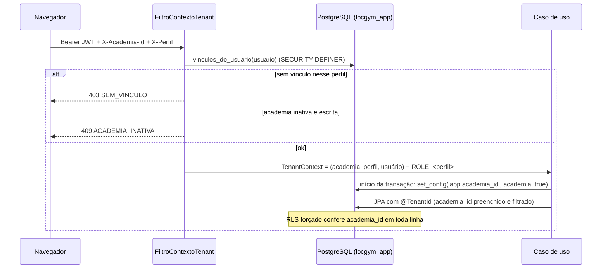

# 05 — Arquitetura

## Visão de containers

```mermaid
flowchart LR
    browser([Navegador]) -->|HTTP :4200| nginx[frontend<br/>nginx + SPA Angular]
    nginx -->|/api, /actuator/health| backend[backend<br/>Spring Boot 4 / Java 21]
    backend -->|JPA / Flyway| pg[(PostgreSQL 17)]
    backend -->|outbox relay| kafka[(Apache Kafka 4.3<br/>KRaft)]
    kafka -.->|consumidores<br/>(notificação, Fase 2+)| backend
```

- O navegador fala **só com o nginx**; o nginx faz proxy de `/api` e `/actuator/health` para o backend usando o DNS do Docker (re-resolvido a cada 10 s, sobrevive a reinícios do backend).
- O **frontend não depende do Kafka**; o backend fica *ready* sem o Kafka (ver [ADR-004](09-decisoes-tecnicas.md)).

## Backend: monolito modular

Um único deployable dividido em módulos de negócio verificados pelo **Spring Modulith** (`ApplicationModules.verify()` em `ArquiteturaTest`).

| Módulo | Responsabilidade | Fase |
|---|---|---|
| `compartilhado` | Infra técnica aberta a todos: eventos/outbox, tratamento de erros | ✅ 1 |
| `identidade` | Usuários, login, JWT, refresh, vínculos, filtro de contexto | ✅ 2 |
| `academia`, `aluno`, `professor`, `plano` | Cadastros | ✅ 2 |
| `matricula`, `pagamento` | Cobrança recorrente, inadimplência, job diário | 3 |
| `agenda`, `frequencia` | Horários, aulas, check-in | 4 |
| `relatorio`, `notificacao` | Indicadores; consumo de eventos | 5 |

### Camadas (Clean Architecture) dentro de cada módulo

```
com.locgym.<modulo>
├── dominio          entidades e regras — sem Spring, JPA ou Jackson
├── aplicacao        casos de uso e portas — não conhece infraestrutura nem web
├── infraestrutura   adaptadores: JPA, Kafka, agendamentos
└── web              controllers e DTOs REST
```

Regras verificadas por ArchUnit: `dominio` não depende de framework nem de outras camadas; `aplicacao` não depende de `infraestrutura` nem de `web`. Módulos conversam por API pública ou eventos — nunca pelos repositórios uns dos outros.

## Eventos

Transactional outbox → Kafka: detalhes em [07 — Eventos](07-eventos.md).

## Multi-tenancy (Fase 2)



- **Duas camadas:** Hibernate `@TenantId` (`EntidadeDeTenant`) e Row-Level Security forçado. Mesmo SQL nativo só enxerga a academia da transação.
- **Contexto por requisição:** `TenantContext` é definido pelo filtro e sempre limpo no fim; o vínculo é consultado no banco a cada requisição (remoções valem na hora).
- **Papel `locgym_app`:** a aplicação nunca conecta com um papel que ignore o RLS — nem nos testes.
- **Tabelas globais** (`usuario`, `academia`, `administrador_academia`, `refresh_token`) ficam sem RLS e são acessadas sempre pela academia do contexto ou pelo próprio usuário.
- **Auditoria** grava na mesma transação; para operações fora do contexto da academia afetada (criação de academia), há `registrarNaAcademia`.

## Frontend

Angular 22 (standalone, signals), Angular Material, rotas com carregamento sob demanda:

| Rota | Conteúdo | Fase |
|---|---|---|
| `/` | Página inicial com status do backend | ✅ 1 |
| `/login`, `/criar-academia`, `/trocar-senha`, `/selecionar-academia`, `/nova-academia` | Sessão e escolha de academia | ✅ 2 |
| `/admin/{alunos,professores,planos,administradores,academia}` | Painel por módulos | ✅ 2 |
| `/aluno/meus-dados` | Portal do aluno (somente leitura) | ✅ 2; demais telas na Fase 5 |

## Infraestrutura

- `docker-compose.yml`: postgres, kafka, backend, frontend (+ `kafka-ui` no profile `tools`), com healthchecks; o backend espera o Postgres saudável e o Kafka apenas iniciado, e o frontend espera só o backend ter iniciado — nenhum dos dois depende da saúde do Kafka.
- Imagens multi-stage; backend roda como usuário não-root (uid 10001).
- CI (GitHub Actions): backend (`./mvnw verify`), frontend (lint, testes, build) e build das imagens.
