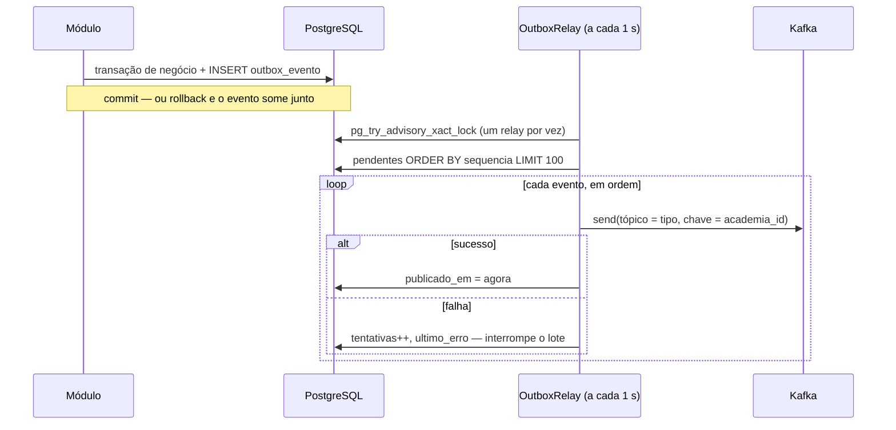

# 07 — Eventos

## Como publicar

Um módulo publica um evento de domínio pela porta `PublicadorEventos`, **dentro da sua transação**:

```java
record CheckinRegistrado(UUID academiaId, UUID alunoId, Instant entradaEm) implements EventoDominio {
    public String tipo() { return "checkin.registrado"; }
    public int versao() { return 1; }
}

@Transactional
void registrar(...) {
    // ... grava o check-in ...
    publicador.publicar(new CheckinRegistrado(academiaId, alunoId, agora));
}
```

Chamar `publicar` fora de transação lança `IllegalTransactionStateException`.

## Transactional outbox



Garantias:
- **Atomicidade:** o evento existe se e somente se a transação de negócio foi confirmada.
- **Retry:** um evento com falha continua pendente e é tentado de novo no próximo ciclo; `tentativas` e `ultimo_erro` ficam registrados.
- **Ordem:** publicação em ordem de `sequencia`, interrompida na primeira falha (nenhum evento posterior passa à frente); um único relay ativo por vez (advisory lock); chave = `academia_id` mantém os eventos de cada academia — e de cada agregado dela — na mesma partição.
- **Entrega at-least-once:** consumidores devem ser idempotentes por `evento_id` (presente no envelope e no header Kafka `evento_id`).
- **Kafka indisponível** não derruba o backend: os eventos acumulam no outbox.

Configuração (`locgym.outbox.*`): `relay-habilitado` (true), `intervalo-ms` (1000), `lote` (100), `timeout-envio-ms` (5000).

## Envelope

```json
{
  "evento_id": "0b8f5c6e-6a51-4a39-9f0e-3c9d1f0a7a11",
  "tipo": "checkin.registrado",
  "academia_id": "5d0c2f7e-1d6b-4c43-8a8b-2a4c9b7e1f00",
  "ocorrido_em": "2026-11-21T21:40:00.123Z",
  "versao": 1,
  "dados": { "alunoId": "…", "entradaEm": "…" }
}
```

Chave da mensagem: `academia_id` (ou `evento_id`, se o evento não tiver academia).

## Catálogo de tópicos (planejado)

| Tópico | Produtor | Consumidores previstos | Fase |
|---|---|---|---|
| `matricula.criada` | matricula | notificacao, relatorio | 3 |
| `matricula.renovada` | matricula | notificacao (aviso de renovação) | 3 |
| `matricula.vencida` | matricula (job diário) | notificacao | 3 |
| `matricula.suspensa` | matricula | notificacao | 3 |
| `matricula.reativada` | matricula | notificacao | 3 |
| `matricula.cancelada` | matricula | notificacao, relatorio | 3 |
| `pagamento.gerado` | pagamento (job diário) | notificacao (aviso de vencimento) | 3 |
| `pagamento.registrado` | pagamento | matricula (estende vigência), notificacao | 3 |
| `pagamento.atrasado` | pagamento (job diário) | notificacao (atraso/inadimplência) | 3 |
| `checkin.registrado` | frequencia | notificacao (confirmação), relatorio | 4 |
